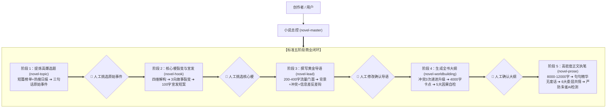

# Novel Master (小说总控) v3.7

全流程中文商业短篇小说创作单一总控智能体系统（知乎盐选 / 番茄 / 点众 / 七猫短篇工业化标准 SOP）。

## 系统五阶段核心流水线

本系统采用严格的“五阶段创作推进 + 四处人工确认卡点”设计：

## 核心设计特性

1. **5 阶段全流程 + 4 处强制人工确认**：
   - 绝不擅自跳步越级，每一步基于上一步作者挑选和修改确认的结果推进。
2. **100 字爆款宣传吸睛短文案**：
   - 在核心梗阶段同步生成用于小红书、信息流引流的超短吸睛文案。
3. **200~400 字黄金导语门面**：
   - 贯彻“背景 + 冲突 + 钩子（冲突+信息差，如‘将军迎我做妾，不知我将成为储君’）”，精准拿捏信息披露尺度。
4. **4000 字黄金付费卡点与 5 大因果自检**：
   - 卡在“马上要反击”但“还没彻底反击”的“将爽未爽”点，冲突至少 3 次递进升级，严格自检终点、具象目标、状态变化与因果链。
5. **8000~12000 字高密度高共情执笔**：
   - 每句话必须完成三任务之一（推进剧情、补充关键信息、抬高情绪），直击 6 大委屈共情（被忽视、被背叛、被误解、被压迫、被委屈、被辜负）。
6. **抗朱雀 AI 检测军规**：
   - 彻底封死三重否定排比句（“没有没有甚至”）、禁止角色借嘴报账、废除功能 NPC 背书、粉碎经典反应链条。

## 文件组成

- `SKILL.md` / `小说总控.md`：顶层总控中枢调度脚本与规范（v3.7）
- `选题挖掘.md`：全网短篇榜单与热搜热点捕捉引擎 (`novel-topic`)
- `核心梗裂变.md`：四维情绪解构、三向故事裂变与 100 字宣发短案引擎 (`novel-hook`)
- `导语创作.md`：200~400 字商业短篇黄金导语与入口钩子引擎 (`novel-lead`)
- `架构策划.md`：4000 字卡点、冲突升级链与 5 大自检全书大纲引擎 (`novel-worldbuilding`)
- `正文执笔.md`：8000~12000 字高密度、6 大委屈共情与抗 AI 检测执笔引擎 (`novel-prose`)
- `毒舌审校.md`：商业卡点吸引力、弃读率与朱雀 AIGC 风险前置防火墙 (`novel-review`)
- `章节归档.md`：章节摘要与底层台账自动回填闭环 (`novel-archiving`)
- `考据推演.md`：真实制度、法理与逻辑考据 (`novel-research`)
- `记忆存取.md`：设定库跨章节状态一致性维护 (`novel-memory`)
- `题材风格库/`：各题材专业词汇、冲突公式与行话物料库
