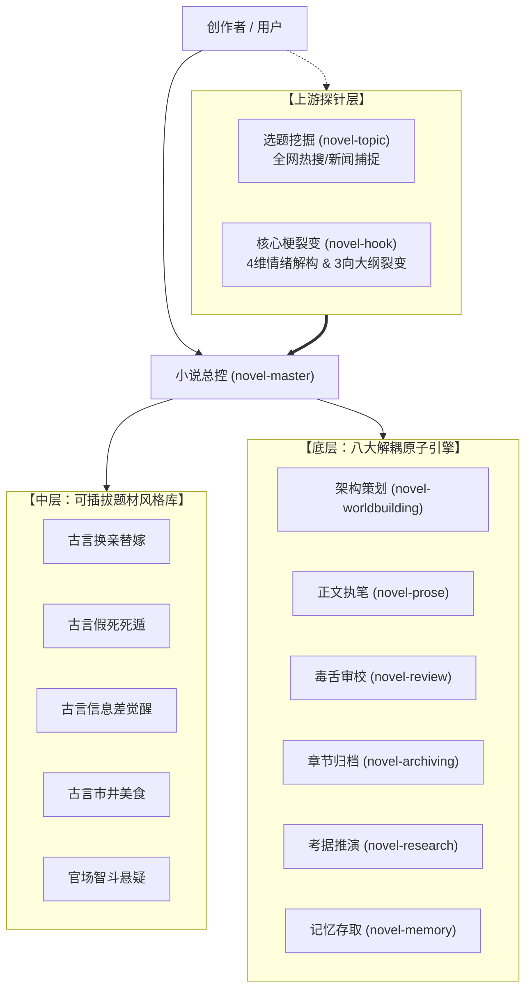

# Novel Master (小说总控) v3.2

全流程中文商业小说与短篇故事写作单一总控智能体系统。

## 系统架构

本系统采用“上游探针 ➔ 顶层中枢 ➔ 中层风格 ➔ 底层原子引擎”的全链路解耦架构：

## 核心设计特性

1. **双轨架构解耦**：
   - **短篇极速流（1~2万字知乎/番茄短篇）**：纯文档极简流，无重型数据库负担，单大纲锁定 8 节拍与 3000 字双付费钩子；
   - **长篇宏大架构流（几十万字连载）**：5 大解耦底层数据库（人物/关系/时间线/伏笔/世界观）+ 记忆引擎防吃设定。
2. **商业节拍控制**：内置 8 步商用节拍表（Beat Sheet）与第 3000 字前置双付费卡点机制。
3. **开篇强抓手**：黄金 300 字开局动作化起步，开局即见血，杜绝背景长篇叙述与天气空洞抒情。
4. **角色设定标准**：主角坚持「不圣母、不拖沓、绝不原谅」三不原则，反派配置伪善道德绑架口癖与推诿算计。
5. **去 AI 味执笔**：严控 15 大 AI 陈词滥调，坚持五感白描与生活流动作白描。
6. **多端协同支持**：支持 Google Antigravity、Claude Code、Cursor 与 Obsidian 环境。

## 文件组成

- `SKILL.md` / `小说总控.md`：顶层总控中枢调度脚本与规范（v3.2）
- `选题挖掘.md`：全网热搜热点捕捉与三句话原始事件提炼引擎
- `核心梗裂变.md`：四维情绪解构与三大方向（追妻/世情逆袭/悬疑）裂变引擎
- `架构策划.md`：短篇节拍大纲 / 长篇五大解耦底表初始化引擎
- `正文执笔.md`：分场景五感白描、情绪代偿与防 AI 味执笔引擎
- `毒舌审校.md`：证据链排查、卡点付费转化力与爽点憋屈度质检引擎
- `章节归档.md`：章节摘要与底层台账自动回填闭环
- `考据推演.md`：历史制度、物价与物理逻辑考据
- `记忆存取.md`：设定库跨章节状态一致性维护
- `题材风格库/`：各题材专业词汇、冲突公式与行话物料库
