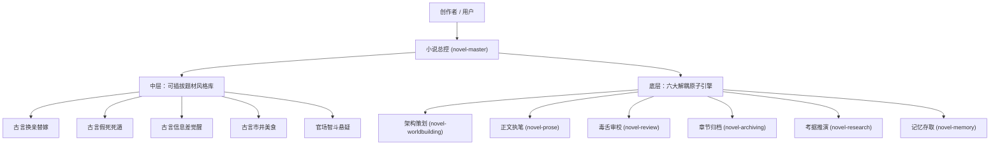

# Novel Master (小说总控)

全流程中文商业小说与短篇故事写作单一总控智能体系统。

## 系统架构

本系统采用三层解耦架构：

## 核心设计特性

1. **商业节拍控制**：内置 8 步商用节拍表（Beat Sheet）与 3000 字前置双付费卡点机制。
2. **开篇强抓手**：黄金 300 字开局动作化起步，避免背景长篇叙述。
3. **角色设定标准**：主角坚持「不圣母、不拖沓、绝不原谅」三不原则，反派配置伪善道德绑架口癖。
4. **多端协同支持**：支持 Google Antigravity、Claude Code、Cursor 与 Obsidian 环境。

## 文件组成

- `SKILL.md` / `小说总控.md`：顶层总控中枢调度脚本与规范
- `架构策划.md`：大纲推演与解耦底表初始化引擎
- `正文执笔.md`：分场景五感白描与防 AI 味执笔引擎
- `毒舌审校.md`：证据链排查与商业卡点质量审校引擎
- `章节归档.md`：章节摘要与底层台账自动回填闭环
- `考据推演.md`：历史制度、物价与物理逻辑考据
- `记忆存取.md`：设定库跨章节状态一致性维护
- `题材风格库/`：各题材专业词汇、冲突公式与行话物料库
