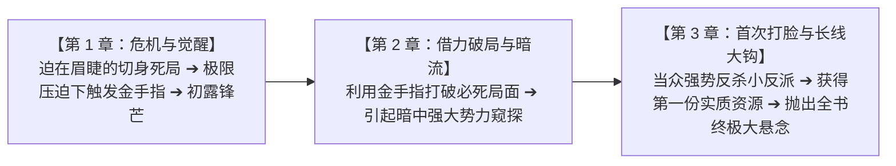

# 长篇小说阶段三：黄金前三章破局开篇规范

> **定位**：长篇网络连载小说的“生死三章”。
> **核心使命**：解决起点/番茄等长篇渠道的“3万字签约率”、“首章留存率”与“前三章追读率”。
> **铁律**：前三章严禁大段背景设定灌输，严禁流水账描写童年，必须直接把主角扔进危机熔炉！

---

## 一、 破局开篇三大结构（黄金三章法则）

### 第 1 章：危机降临与金手指觉醒（抓眼球）
1. **开篇前 500 字**：
   - 绝不介绍大陆几万年历史，直接切入核心主角的**当下生死/名誉危机**（如：明天就要被挖灵骨、今夜有刺客摸进柴房、三日内交不出供奉就要被贬为炉鼎）；
   - 展示主角的真实困境与不甘隐忍的人格特质；
2. **中间段（500~1500字）**：
   - 反派当面施压，踩碎主角尊严，甚至直接动手；
   - 危机达到濒死临界点；
3. **末尾段（1500~2500字）**：
   - **金手指在极限压迫下觉醒/开启**！展示金手指的最初级界面或神异变化；
   - 主角迅速冷静，敏锐捕捉到破局的一线生机；
   - **章末钩子**：主角眼中寒芒一闪，锁定了即将反击的目标。

### 第 2 章：借力破局与暗流涌动（立人设）
1. **破局初试**：主角依靠金手指的初级能力（或信息差推演），完成第一次“不可能的微型自救”；
2. **展现智慧与果断**：主角不盲目狂妄，而是杀伐果决、心思缜密，迅速抹除对自己不利的痕迹；
3. **引出更大危机**：主角虽然躲过了小喽啰的暗算，但意外撞破了更高层人物的阴谋，或者金手指的动静引起了暗中高手的注意；
4. **章末钩子**：次日清晨的公开大考/家族审判即将开始，反派正带着人堵在门外准备坐实罪名。

### 第 3 章：首次打脸与长线大钩子（放爽点+留长钩）
1. **公开场合反转**：在家族大堂、宗门广场等众目睽睽之下，反派得意洋洋指控主角必死无疑；
2. **当众强势打脸**：主角拿出铁证或展现脱胎换骨的实力，当场击溃反派阴谋，让反派自食恶果（断其前途、收回资产或当场废黜）；
3. **获得实质奖赏**：主角拿到第一笔核心修仙资源（如进入藏经阁的令牌、第一颗破境丹药）；
4. **抛出全书主线第一大悬念（长线大钩子）**：
   - 例如：从死去的反派身上搜出印有神圣皇族徽章的绝密信件；
   - 或者：金手指突然浮现一行血字警告：“三年之后，九星连珠，域外天魔将血祭此界”；
   - **读者心理**：小高潮爽到了，同时被一个更大的谜团死死钩住，产生极强的自动追读欲望！

---

## 二、 黄金前三章自检清单

在输出给作者前，必须逐一核对：
- [ ] 第 1 章是否在前 1000 字内交代清楚主角的金手指？
- [ ] 第 1 章是否有迫切的倒计时或生死威胁？
- [ ] 主角是否在第 2 章展现出了主动智斗，而非纯靠运气？
- [ ] 第 3 章打脸是否当众发生？反派是否付出了不可挽回的代价？
- [ ] 第 3 章结尾是否留下了足以支撑后续 50 章的主线悬念？

**🛑 强制确认节点**：输出前三章逐章细纲与开场设计，停步等待作者审定确认。
